<h1>
<picture>
  <source media="(prefers-color-scheme: dark)" srcset=".github/assets/banner-dark.svg" />
  
</picture>
</h1>

[](https://github.com/VincentJerico/playwright-framework-template/actions/workflows/ci.yml)


<sub>QA portfolio: [01 journey](https://github.com/VincentJerico/qa-engineering-journey) · **02 framework** · [03 api](https://github.com/VincentJerico/api-testing-framework) · [04 taskflow](https://github.com/VincentJerico/taskflow-under-test) · [05 accessibility](https://github.com/VincentJerico/accessibility-testing) · [06 security](https://github.com/VincentJerico/security-testing) · [07 performance](https://github.com/VincentJerico/performance-testing) · [profile](https://github.com/VincentJerico)</sub>

A reusable Playwright and TypeScript test framework. It's the structure I'd start a real UI
automation suite from, with custom fixtures, page objects, per-environment config, login state
saved once and reused, data factories, cross-browser projects, tags, linting and CI.

> The demo target is [SauceDemo](https://www.saucedemo.com) so it runs out of the box. Point it at your
> own app by changing `src/config/env.ts` and the page objects.

## How it's organized

| Pattern           | Where                                   | Why                                                             |
| ----------------- | --------------------------------------- | --------------------------------------------------------------- |
| Custom fixtures   | `src/fixtures/test.ts`                  | Page objects arrive as fixtures, so specs stay short            |
| Page Object Model | `src/pages/`                            | UI selectors live in one place; tests read like behavior        |
| Multi-env config  | `src/config/env.ts`                     | `TEST_ENV=dev\|staging\|prod` or `BASE_URL`, no hard-coded URLs |
| Auth reuse        | `tests/auth.setup.ts` + `setup` project | Log in once, save the session, reuse it in every spec           |
| Data factories    | `src/data/factory.ts`                   | Faker data, so tests don't share brittle fixtures               |
| Cross-browser     | `playwright.config.ts` projects         | Chromium, Firefox, WebKit and mobile Chrome                     |
| Tagging           | `@smoke` in titles                      | `npm run test:smoke` for a fast subset                          |
| Quality gates     | ESLint, Prettier, typecheck, CI         | Lint, format and type errors fail the build                     |

## Getting started

```bash
npm install
npm run install:browsers      # Playwright browsers
npm test                      # all projects
npm run test:chromium         # single browser (fast local loop)
npm run test:smoke            # @smoke subset
npm run report                # open the HTML report
```

### Configuration

Copy `.env.example` to `.env` to set `TEST_ENV`, `BASE_URL`, or credentials; shell variables win over
`.env`. Credentials fall back to SauceDemo's public demo user (`standard_user` / `secret_sauce`) only
while the target is SauceDemo. Point `BASE_URL` or an environment at your own app and the run stops at
startup until `SAUCE_USERNAME` and `SAUCE_PASSWORD` are set, in CI as well as locally.

## Structure

```
playwright-framework-template/
├── playwright.config.ts        # projects, reporters, env-driven baseURL, auth reuse
├── src/
│   ├── config/env.ts           # environment + credentials resolution
│   ├── fixtures/test.ts        # custom test fixtures (page objects)
│   ├── pages/                  # BasePage · LoginPage · InventoryPage
│   └── data/factory.ts         # faker data factories
└── tests/
    ├── auth.setup.ts           # authenticate once → storage state
    ├── login.spec.ts           # logged-out flows (opts out of stored session)
    ├── inventory.spec.ts       # authenticated flows (reuse session)
    └── api.spec.ts             # `api` project: HTTP checks, no browser or login
```

## Extending it

1. Add a page object in `src/pages/` (extend `BasePage`).
2. Expose it as a fixture in `src/fixtures/test.ts`.
3. Write specs against the fixture; tag critical ones `@smoke`.
4. Add data builders to `src/data/factory.ts` as needed.

## CI

[`.github/workflows/ci.yml`](.github/workflows/ci.yml) runs lint, format and typecheck first. Then
the E2E suite runs on Chromium, Firefox, WebKit and mobile Chrome in a matrix, uploading an HTML
report per browser, and the `api` project runs in its own job without a browser.
CI retries a failed test twice so the report captures a trace, but `failOnFlakyTests` still fails the
run when a retry passes, so flakiness gets fixed instead of hidden.
