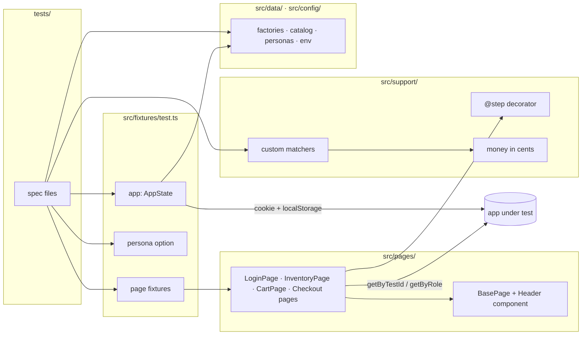

# Architecture

How a test gets from a spec file to a browser, and where each concern lives.

## Layers

| Layer        | Lives in                   | Job                                                                    | Never does                   |
| ------------ | -------------------------- | ---------------------------------------------------------------------- | ---------------------------- |
| Specs        | `tests/`                   | State one behavior each, in the app's language                         | Hold selectors or raw clicks |
| Fixtures     | `src/fixtures/test.ts`     | Build page objects, apply the persona, offer `app` for arranging state | Assert anything              |
| Page objects | `src/pages/`               | One class per page: locators, actions (as steps) and `expectLoaded()`  | Decide whether a test passed |
| Components   | `src/pages/components/`    | UI shared by many pages (the header and menu)                          | Navigate on their own        |
| Support      | `src/support/`             | Cross-cutting helpers: step reporting, matchers, money                 | Know about a specific page   |
| Data         | `src/data/`, `src/config/` | Factories, the catalog, personas, environment and credentials          | Hard-code prices or totals   |

## Decisions

**Locators.** `getByTestId` (the demo marks elements with `data-test`, set as `testIdAttribute`) and
`getByRole` for buttons by their visible name. Products are found by their visible name, not by a
generated id, so a test reads like the page.

**Arrange through state, act through the UI.** A cart test that's about removing an item doesn't
click "Add to cart" three times first: `app.seedCart()` writes the cart directly. Only the end-to-end
journey goes through every screen. The demo keeps its session in a cookie and the cart in
`localStorage`; on a real app, `AppState` would call the app's API instead.

**Personas.** `test.use({ persona: 'problem' })` runs a file as another demo user by setting the
session directly, without a login step or an extra setup project per user.

**Steps.** Page-object actions carry `@step()`, so reports and traces show
`Add Sauce Labs Backpack to the cart` instead of a list of clicks.

**Money in cents.** Totals are checked with integer cents (`src/support/money.ts`), so a total that is
off by a cent fails and floating point can't hide it.

**Known defects are pinned, not skipped.** `tests/problem-user.spec.ts` asserts the demo's current
wrong behavior and names the issue. When the bug is fixed the test goes red, and someone updates it.
`test.fail()` is banned by ESLint because it also swallows unrelated failures.

**Navigation waits for the DOM, not `load`.** `load` also waits for third-party fonts and scripts,
which stalled navigations under parallel runs while the app was already usable. Each page's
`expectLoaded()` waits for real content instead. The demo's error telemetry is blocked in tests so
the suite doesn't report fake errors to it or depend on it.

**Guards are tested.** `selftest/planted.spec.ts` holds one planted failure per guard (each matcher,
the money parser, a page assertion). `npm run selftest` passes only if every one of them fails, for
its own reason. CI runs it on every push.
